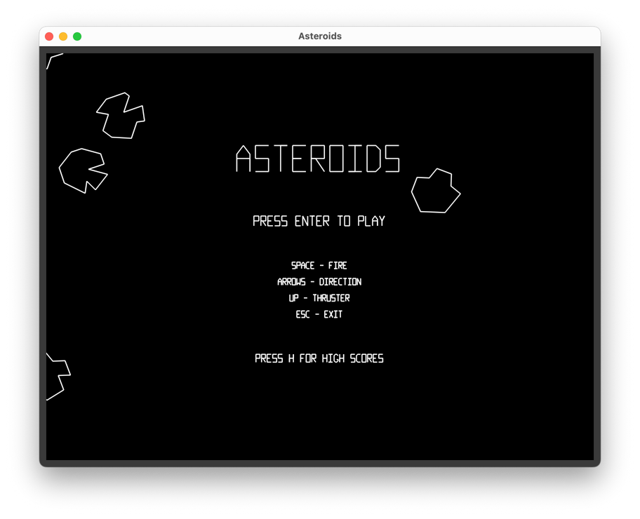

# Asteroids

Be thrilled by this high fidelity reproduction of Atari's 1979 classic, Asteroids!

This is a tidied up version of an Asteroids clone that I wrote over the course of several weekends, as a way to procrastinate while studying for exams. The aim was to get the game running quickly, taking a 'less-is-more' approach. Graphics were implemented using legacy OpenGL, while window management, audio and input were all handled by SDL.



## Ports

This project has also been ported to the web using Emscripten, which I wrote about in [this blog post](https://tristanpenman.com/blog/posts/2018/01/08/porting-an-asteroids-clone-to-javascript/), and later to the venerable Nintendo 64 and the SEGA Dreamcast. The code for the N64 port can be found [here](https://github.com/tristanpenman/asteroids64).

## Demo

A playable demo can be found [here](https://tristanpenman.com/demos/asteroids).

If you want to try the N64 version (using either an emulator or a flash-cast such as the Everdrive 64) you can download the ROM [here](https://tristanpenman.com/demos/asteroids/asteroids.n64).

## Dependencies

* SDL2
* SDL_Mixer2
* CMake
* Emscripten (for web builds)

## Build

### macOS and Linux

The project currently depends on SDL2 and SDL2_mixer, and builds are handled by CMake. Once those dependencies are installed (e.g. using Homebrew or apt), native macOS and Linux builds are relatively simple:

```bash
mkdir build
cd build
cmake ..
make
```

### Windows

The project's CMake configuration can also be used to generate Visual Studio project files. However, you will need to extract the archives in [thirdparty](./thirdparty) before you can do this.

Once those archives have been extracted, CMake GUI should be able to generate a VS solution using the default configuration.

### Web

Use `./scripts/build-web.sh` to build a distributable version of the game with the Dockerised Emscripten toolchain:

```bash
./scripts/build-web.sh
```

The build output is written to `embuild` and owned by the current user. It contains `index.html`, `asteroids.js`, `asteroids.wasm`, `asteroids.data`, and the preloaded game assets.

The files must be loaded through an HTTP server rather than opening `embuild/index.html` directly. To build the game and serve it using the same Docker image, run:

```bash
./scripts/build-web.sh serve
```

Then open <http://localhost:8000> in a browser. Stop the server with <kbd>Ctrl</kbd>+<kbd>C</kbd>.

The `emscripten/emsdk` image is published for `linux/amd64`, so it runs under emulation on Apple Silicon. This is suitable for building and serving the game, although compilation may be slower.

Alternatively, with Emscripten installed locally, configure and build from the repository root:

```bash
emcmake cmake -S . -B embuild
emmake cmake --build embuild
```

Run the local build with Emscripten's development server:

```bash
emrun embuild/index.html
```

### Nintendo 64 (via Docker)

The initial Nintendo 64 target can be built with the N64 SDK container:

```bash
./scripts/build-n64.sh
```

The resulting ROM is written to `build-n64/asteroids.z64` and owned by the current user.

### SEGA Dreamcast (via Docker)

The Dreamcast build uses KallistiOS. Run `./scripts/build-dreamcast.sh` to build `build-dreamcast/asteroids.elf` and its linker map. The first build compiles the KOS v2.1.0 toolchain in Docker and can take a long time; subsequent builds reuse the image.

To build a self-bootable CDI image for GDEMU, run:

```bash
./scripts/build-dreamcast.sh cdi
```

The image is written to `build-dreamcast/asteroids.cdi`. Use `./scripts/build-dreamcast.sh bin` to create a raw binary instead. Set `BUILD_DIR` to choose a different output directory, for example:

```bash
./scripts/build-dreamcast.sh BUILD_DIR=build-dreamcast/release BUILD=release cdi
```

With KallistiOS installed locally, source its `environ.sh` and run `make -f dreamcast/Makefile` from the repository root. The Makefile reports a clear error if `KOS_BASE` is not configured.

## License

This code has been released under the MIT License. See the [LICENSE](LICENSE) file for more information.

### Assets

Game assets are under copyright by Atari.

The graphics and audio that have been reproduced here are all used in good faith. The clone is intentionally incomplete, so as to not detract from the value of any Atari releases of the game.
